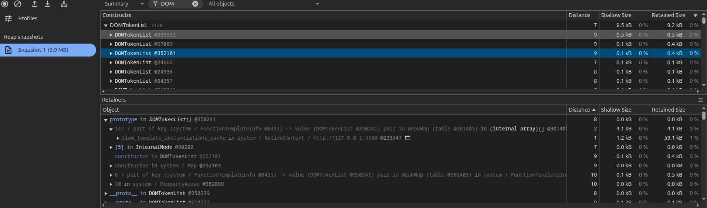

# Memory Leak

## GC Root Object

Object always reachable such as:

- window
- document
- Global variables
- Active Stacks / Closure

## GC - Garbage Collection

- GC will remove all reference not reachable

## Reachable

- A Object is reachable if it is referenced by another object

## 1. HEAP Snapshot

### 1.1 Distance

> **Distance = the shortest number of references from a GC root to that object**

```js
window.store = {
  cache: {
    item: {},
  },
};
```

store → distance 1

cache → distance 2

item → distance 3

### 1.2 Retainer

Using to find where find object reach its obj


### 1.3 Comparison mode

- Comparison with previous snapshot

### 1.4 Detach element keyword

- Find "detach" keyword to find DOM elements
- DOM elements detached mean:
  - The elements is no longer in the DOM (UI)
  - But it is still reachable from Javascript
- CLick to Retainers to find object reference it
